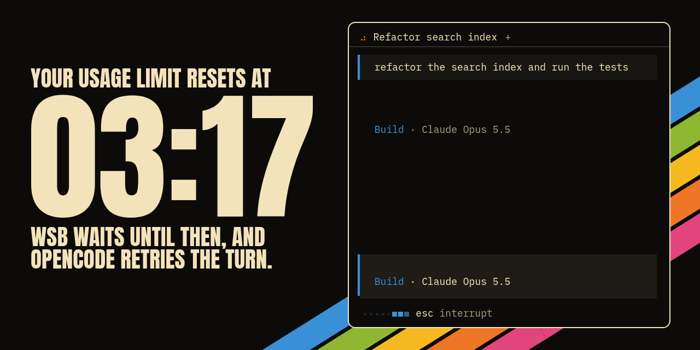

# wsb

[](https://wsb.tsu.ar/)

OpenCode plugin. When your subscription hits its usage limit, it waits for the reset and retries the same turn.

```sh
opencode plugin add github:tsu-ld/wsb
```

Works with Claude subscriptions (through `opencode-with-claude` or OpenCode's `claude-agent` provider), ChatGPT/Codex and OpenCode Go.

wsb is not built by the OpenCode team and is not affiliated with it.

## Develop

```sh
bun install && bun run check && bun scripts/e2e.js
```

`src/opencode/tui.tsx` compiles to `dist/tui.js`, which is committed because git installs load it. `bun run check` fails when the build is stale.
