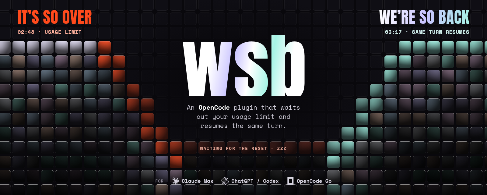

# wsb

[](https://wsb.tsu.ar/)

OpenCode plugin. When your subscription hits its usage limit, it waits for the reset and retries the same turn.

```sh
opencode plugin add git+https://github.com/tsu-ld/wsb.git#production
```

Works with Claude Max (via `opencode-with-claude`), ChatGPT/Codex and OpenCode Go.

## Develop

```sh
bun install && bun scripts/build.js && bun check && bun test && bun scripts/e2e.js
```

`src/tui.tsx` compiles to `dist/tui.js`, which is committed because git installs load it. Run the build after changing the TUI part.
