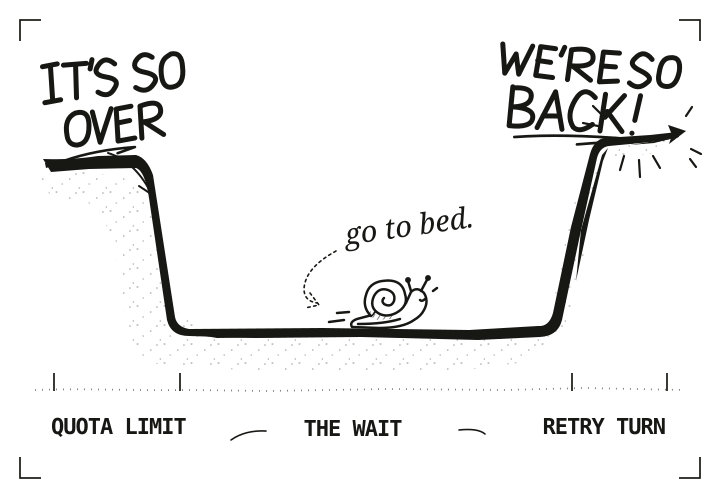

# We’re So Back

[](https://weresoback.tsu.ar/)

OpenCode plugin. When your subscription hits its usage limit, it waits for the reset and retries the same turn.

```sh
opencode plugin add git+https://github.com/tsu-ld/opencode-quota-resume.git#production
```

Works with Claude Max (via `opencode-with-claude`), ChatGPT/Codex and OpenCode Go.

## Develop

```sh
bun install && bun check && bun test && bun scripts/e2e.js
```
